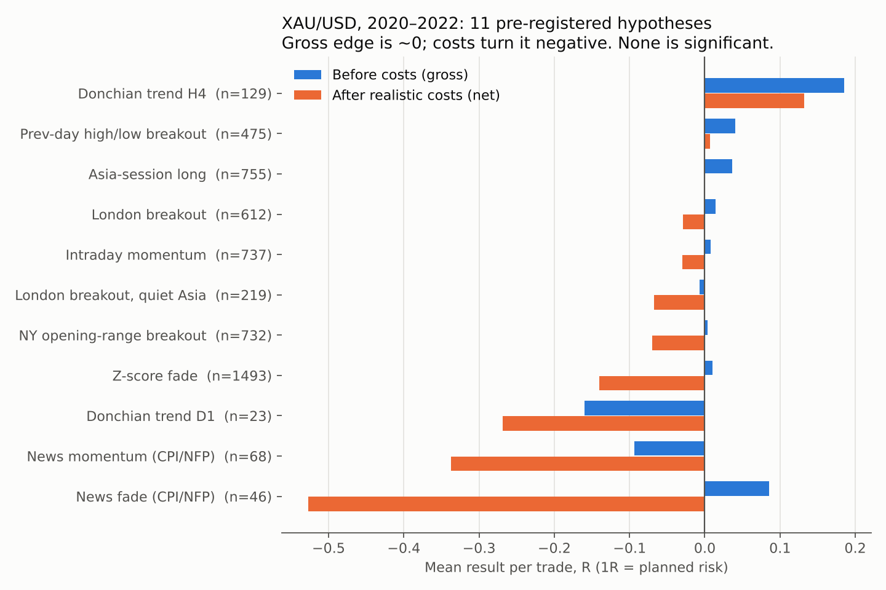
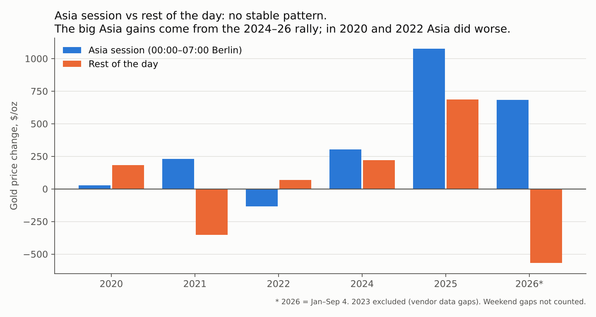

# XAU/USD intraday strategy research: 11 pre-registered tests, no edge found

> **Method in one paragraph.** Every hypothesis was written down with fixed parameters
> *before* it was run ([round 1](research/round1/REGISTRATION_round1.md),
> [round 2](research/round2/REGISTRATION_round2.md)); nothing was tuned afterwards. The pass/fail
> gate uses only 2020–2022 and applies a Bonferroni correction for the number of tests
> (t > 2.84 for 11 tests). 2024–2026 is reported but is **not** a clean out-of-sample period,
> because an earlier experiment had already looked at it. 2023 is excluded because the vendor's
> minute data has 66–71% coverage in February–July. Costs are realistic retail ECN costs,
> and every result is also shown before costs and at 2× costs.

*Research code. Not financial advice, and not a trading system.*

## Result



None of the 11 hypotheses passes. For most of them the edge is about zero **before** costs,
and realistic costs (about $0.47/oz per round trip) push it below zero.
The only one positive in both periods, a 20/10 Donchian trend system on 4h bars, is not
statistically significant (t = 0.6 in 2020–2022) and is near zero in 2020–2022 for every
channel length tested ([sensitivity](research/round2/RESULTS_round2.md)).

| Hypothesis | 2020–22 trades | R before costs | R after costs | t | 2024–26 R after costs |
|---|---|---|---|---|---|
| NY opening-range breakout | 732 | +0.004 | −0.070 | −2.3 | −0.021 |
| London breakout (Asian range) | 612 | +0.014 | −0.029 | −0.9 | +0.042 |
| News momentum (CPI/NFP) | 68 | −0.094 | −0.337 | −2.9 | −0.244 |
| News fade (CPI/NFP) | 46 | +0.086 | −0.527 | −4.1 | −0.367 |
| Donchian trend, daily | 23 | −0.159 | −0.268 | −1.4 | +0.472 |
| Asia-session long | 755 | +0.036 | −0.002 | −0.1 | +0.088 |
| Z-score fade (60-min) | 1493 | +0.010 | −0.140 | −6.6 | −0.093 |
| London breakout, quiet-Asia days | 219 | −0.007 | −0.067 | −1.2 | +0.075 |
| Previous-day high/low breakout | 475 | +0.041 | +0.007 | +0.2 | +0.018 |
| Intraday momentum (last hour) | 737 | +0.008 | −0.030 | −3.2 | −0.007 |
| Donchian trend, 4h | 129 | +0.186 | +0.132 | +0.6 | +0.283 |

R = result per trade in units of the planned risk (stop distance).

### The one that looks good in 2024–2026 is a trap

"Asia-session long" makes +0.088R per trade in 2024–2026 (t = 3.7), but that period is a
strong gold rally. Split by year, the Asia session does better than the rest of the day in
some years and worse in others (2020, 2022): its big gains come from the rally, so this is
market exposure, not an edge.



## Setup

| | |
|---|---|
| Data | [HistData](https://www.histdata.com) XAUUSD M1 (bid), 2020-01 to 2026-09-04. Not included: download it yourself. |
| Clock | vendor timestamp + 6 h = Europe/Berlin wall time, checked against 370 release times (median 1-minute range is 9.8 at the CPI/NFP minute vs 1.3 one minute before) |
| Calendar | [data/economic_calendar.csv](data/economic_calendar.csv): 370 CPI, NFP, PPI, GDP, FOMC releases, each with the official source URL |
| Costs | spread $0.30, commission $0.07 round trip, slippage $0.05 per side; news entries $0.80 / $0.20; financing 5%/yr long, 1%/yr short for multi-day trades |
| Execution | signal on bar close, fill at next 1m open; exits on 1m bars; stop counted first if stop and target hit in the same bar |
| Sanity check | the NY opening-range test reproduces an earlier independent implementation (732 vs 737 trades, same ~0 gross edge) |

## Reproduce

```bash
pip install -r requirements.txt
# put the HistData M1 CSV files (one per year or month) in data/market/
python src/load.py data/market bars.parquet
python src/harness.py  bars.parquet data/economic_calendar.csv r1   # round 1 → r1_summary.csv
python src/harness2.py bars.parquet data/economic_calendar.csv r2   # round 2 → r2_summary.csv
python src/sens.py data/economic_calendar.csv                       # Donchian 4h sensitivity
```

Each harness runs in seconds and writes `<prefix>_summary.csv` and `<prefix>_trades.csv`.

## Limitations

- One instrument, about 5.5 years. Trend following in particular cannot be confirmed or
  rejected on that little data.
- Constant costs; real spreads widen at news and at the daily rollover.
- Bid-only data; the spread is modelled, not observed.
